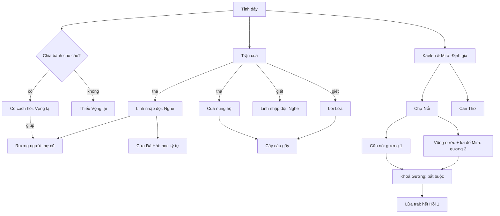

# Nghiên cứu & đề xuất cơ chế giải đố: Trong · Hồi 1

> PROTOTYPE - NOT FOR PRODUCTION. Viết ngày 12/11/2026, sau iteration 3 (`84717d3`).
> Nguồn ở cuối tài liệu. Chỗ nào là suy đoán của tôi chứ không phải của nguồn thì ghi *(đề xuất)*.

## 1. Những gì các game giỏi nhất làm (tóm tắt nguồn)

| Game / tác giả | Bài học dùng được cho Trong |
|---|---|
| **Ron Gilbert**: biểu đồ phụ thuộc câu đố (Maniac Mansion, Thimbleweed Park) | Vẽ câu đố thành sơ đồ "cái này mở cái kia" để thấy chỗ nghẽn. Sơ đồ dài và hẹp là game tuyến tính; rộng là người chơi có nhiều việc để làm khi kẹt. Mỗi phòng phải có lý do tồn tại. |
| **The Case of the Golden Idol** | Mục tiêu là khoảnh khắc "À!": từ rối rắm đến hiểu chuyện gì đã xảy ra. Manh mối tối giản, chỉ phục vụ lời giải hoặc đánh lạc hướng có chủ đích. Cảnh quá nhiều chi tiết thừa làm người chơi ngợp. Giấu bớt manh mối quá lộ. Đáp án nhập bằng **ngân hàng từ** (từ khoá nhặt được), đứng giữa gõ tự do (bực vì sai cú pháp) và trắc nghiệm (mất suy luận). Chấm cả câu đố đúng/sai làm người chơi bực, nên họ thêm báo "sai ≤ 2 ô", nhưng điều đó làm game dễ và ngắn đi. **Người thiết kế không thể "quên" đáp án**: phải thử với người thật, quan sát im lặng, 5–7 vòng. |
| **Return of the Obra Dinn** | Lucas Pope: "dựng một ma trận rồi điền các cột". Game chỉ xác nhận khi người chơi đúng **trọn 3 trường hợp cùng lúc**, chống đoán mò mà vẫn cho cảm giác tiến bộ *(nguồn thứ cấp)*. |
| **Chants of Sennaar** | Ký hiệu xuất hiện ở nhiều chỗ khác nhau (biển cần gạt, van…) nên người chơi tự suy ra nghĩa từ ngữ cảnh. Đoán được ghi vào sổ trước; game chỉ khoá đáp án khi **đúng cả một trang**. Mỗi ngôn ngữ chỉ khoảng 30 từ, đủ để vui mà không thành bài học ngôn ngữ thật. Chen thể loại khác (đẩy khối, lén lút) làm loãng vòng chơi chính. |
| **Outer Wilds** | Tiến bộ duy nhất là **kiến thức**, không có đồ hay chỉ số. Nhật ký tàu ở chế độ "tin đồn" là một đồ thị: nút manh mối, dấu "?", gợi ý "ở đây còn nữa". Người chơi kẹt thì nhìn đồ thị là biết chỗ chưa đi, mà không biến bí ẩn thành danh sách nhiệm vụ. |

## 2. Soi lại 3 câu đố hiện tại (nói thẳng)

| Câu đố | Điểm được | Điểm yếu |
|---|---|---|
| Cửa Đá Hát | Manh mối rải khắp thung lũng; có một bước suy ra "đồi sắt im tiếng"; cáo thưởng cho lựa chọn tốt | Câu khắc **gọi thẳng tên 4 nơi**, ống ghi thẳng ký tự: suy luận chỉ một bước, giống tra bảng hơn là "À!". Sai không mất gì nên có thể đoán mò (625 tổ hợp: dài nhưng làm được) |
| Cây cầu gãy | Kiểu "dùng đồ" cổ điển, có câu đùa khi dùng sai đồ, có hệ quả tha/giết | Ba vạch khớp ba vạch: quá lộ, ai cũng thấy ngay |
| Khoá Gương | Lời đố của Mira ("chỗ ai cũng soi mà chẳng ai nhìn") là khoảnh khắc "À!" thật; câu đố không gian có đúng 1 lời giải | Phần xếp gương là thể loại khác chen vào (bài học từ Chants) |

**Vấn đề chung:**
1. Mỗi manh mối khớp đúng một ô đáp án. Không có **đối chiếu chéo** giữa hai nguồn.
2. Sổ manh mối chỉ **chứa**, không giúp **suy nghĩ**.
3. Không có xác nhận theo nhóm, nên chống đoán mò yếu.
4. Chưa có biểu đồ phụ thuộc. Khoá Gương là nút nghẽn duy nhất của Hồi 1; may là hai tấm gương đến từ hai nhánh độc lập.

## 3. Đề xuất cơ chế: "Bốn cách hỏi thế giới" *(đề xuất)*

Ý cốt lõi: **mỗi vật trong thế giới trả lời khác nhau tuỳ cách hỏi**, và mỗi cách hỏi gắn với một nhân vật đã có sẵn trong handover. Người chơi cầm một vật, chọn một "cách hỏi", nhận một sự thật. Câu đố được giải khi ghép **hai sự thật từ hai cách hỏi khác nhau**.

| Cách hỏi | Ai | Thứ nó cho biết | Gốc trong handover |
|---|---|---|---|
| **Nghe** | Linh | thứ bên trong: rỗng, đặc, đang đập, đã nứt | "thợ máy thính âm", nghe mạch khoáng, rương ẩn |
| **Định giá** | Mira | nguồn gốc: của ai, làm khi nào, đáng bao nhiêu, có phải đồ Thương Đoàn không | "dự báo giá", bàn tính pha lê, cân "0 Lumen" |
| **Vọng lại** | Hồ Ly Âm Bản (chỉ khi đã chia bánh) | âm thanh cũ ở chỗ đó: một câu nói, một tiếng động trong quá khứ | cáo "thu thập âm thanh vụn vặt", phát lại giọng nói cũ |
| **Soi** | Cậu (vũng nước, Mảnh Phản Chiếu) | một khoảnh khắc đóng băng: ai đứng đâu, cầm gì | Vũng Nước Lưu Game, Mảnh Phản Chiếu, Đồng Xu Ký Ức |

Vì sao hợp với Trong:
- **Lựa chọn đạo đức đổi cách bạn suy luận**, không chỉ đổi phần thưởng. Không chia bánh cho cáo thì mất hẳn cách hỏi "Vọng lại" và phải đi đường khác. Tha cua thì con cua cho thêm manh mối.
- **Bạn đồng hành không phải là nút bấm gợi ý.** Mỗi người là một giác quan; thiếu ai là thiếu một cách nhìn thế giới.
- **Tiến bộ là kiến thức** (bài học Outer Wilds), khớp với chủ đề "cậu là ai".

### 3.1 Bàn Ghép (nơi trả lời)
Mỗi câu đố lớn có một **câu chuyện bị khuyết** với các ô trống (bài học Golden Idol). Ví dụ: "___ đã giấu ___ dưới đống ___, vì ___". Các ô được điền bằng **từ khoá** nhặt được khi hỏi thế giới; từ khoá tự vào túi từ. Không có ô gõ tự do, không có trắc nghiệm.

### 3.2 Luật xác nhận (chống đoán mò, không gây bực)
- Chỉ xác nhận khi **đúng trọn một nhóm 3 ô** (Obra Dinn, Chants). Đúng thì nhóm khoá lại, có tiếng chuông, thế giới phản hồi ngay.
- **Không** dùng báo "gần đúng": Golden Idol đã thấy nó làm game dễ đi.
- Sai 3 lần liên tiếp thì bạn đồng hành nói một câu **chỉ ra cách hỏi hoặc nơi chưa hỏi**, không bao giờ nói đáp án ("Cậu đã thử để tôi nghe cái hũ ở lò rèn chưa?").

### 3.3 Sổ có câu hỏi mở (bài học Outer Wilds)
- Mỗi câu đố hiện thành một cụm trong sổ. Các **câu hỏi mở** đánh dấu "?" ("Ai đã giấu?", "Giấu ở đâu?"), nối với các manh mối đã có.
- Câu hỏi nào chưa có manh mối nào thì hiện mờ kèm **tên vùng** còn manh mối, không kèm vị trí chính xác. Kẹt thì mở sổ là biết nên quay lại đâu.

### 3.4 Thang gợi ý ba bậc
1. Bạn đồng hành gợi **cách hỏi** (miễn phí, sau 3 lần sai).
2. Sổ chỉ **vùng** còn manh mối (miễn phí, luôn có).
3. Mira **bán đáp án một ô** bằng Lumen. Giữ kinh tế có ý nghĩa và đảm bảo không ai bị kẹt mãi.

## 4. Ba câu đố mẫu theo cơ chế mới *(đề xuất, chờ duyệt)*

### 4.1 Rương người thợ cũ (Thung Lũng, tuỳ chọn) — dạng "câu chuyện bị khuyết"
- **Bàn Ghép:** "Người thợ của ___ giấu ___ dưới đống ___ trước khi ___."
- **Manh mối (cần đối chiếu chéo):**
  - Định giá chiếc đai dụng cụ ở lò rèn nguội → *"đồ của thợ Thương Đoàn"*, *"ba trăm năm"*.
  - Nghe 4 đống sắt → chỉ đống ống đồng *"rỗng, có vật bằng thiếc"*. Nhưng đống bánh răng *"cũng rỗng, có tiếng chuột"* là mồi.
  - Vọng lại ở lò rèn → một giọng: *"…trước khi họ khoá cổng…"*, cùng tiếng thiếc va.
  - Soi vũng nước gần đó → bóng một người ôm hộp thiếc đi về phía có ánh đồng.
- **Vì sao không đoán mò được:** "rỗng" có hai đống; phải ghép "thiếc" (Nghe) với "hộp thiếc" (Soi) mới loại được đống mồi. Không cho cáo ăn thì mất "Vọng lại" nhưng vẫn giải được bằng ba cách còn lại, chỉ khó hơn.

### 4.2 Cân Thử (Chợ Nổi, tuỳ chọn) — dạng "ma trận"
- Ba loại đá (đỏ, xám, xanh), không biết đá nào nặng bao nhiêu.
- Ba người trong chợ, mỗi người biết một sự thật, phải dùng đúng cách hỏi mới lấy được:
  - Mira định giá: *đá đỏ nặng gấp đôi đá xám*.
  - Linh nghe cái cân của sạp khác: *ba đá xám bằng một đá xanh*.
  - Bà bán đá (nói chuyện thường): *một xanh với một xám thì nặng 8*.
- Suy ra: xám 2, đỏ 4, xanh 6. Cân bọc hàng 10 bằng (đỏ + xanh) **hoặc** (đỏ + đỏ + xám). Có hai đường đúng, theo đúng tinh thần "nhiều đường tới một kết luận" của Golden Idol.
- **Kết:** đặt Khế Ước Trắng (nặng 0) lên cân thì cân lệch hẳn, gieo hạt cho "0 Lumen là vô giá".

### 4.3 Cửa Đá Hát làm lại — dạng "ngôn ngữ ký tự" (học Chants of Sennaar)
- Câu trên cửa **viết bằng 5 ký tự cổ**, không bằng tiếng Việt.
- Nghĩa ký tự học từ nhiều ngữ cảnh: ký tự "Mắt" trên mai cua (lửa) và trên khe hứng Lõi Nhịp Tim; ký tự "Sóng" ở vũng nước và trên Đồng Xu Ký Ức…
- Người chơi đoán nghĩa trong sổ; game xác nhận khi **đúng cả trang 5 ký tự**. Đọc được câu trên cửa thì mới biết đi gõ ống nào.
- **Lợi ích lâu dài:** chính bộ ký tự này nằm trên cửa "Mừng cậu về nhà" ở Hồi 2 và trên tượng Vaelen. Người chơi **đọc được** dòng chữ ấy bằng kiến thức của chính mình. Đó là khoảnh khắc "À!" lớn nhất có thể có cho bí ẩn thân phận.

## 5. Biểu đồ phụ thuộc Hồi 1 (sau đề xuất)

Đọc biểu đồ: chỉ có **một nút nghẽn bắt buộc** (Khoá Gương), và hai nguồn gương của nó độc lập nhau. Bốn câu đố tuỳ chọn tạo bề rộng để người kẹt có việc khác mà làm.

## 6. Cách kiểm tra độ khó (vì người thiết kế không thể "quên" đáp án)

1. **Thử với người thật**, quan sát im lặng, ít nhất 3 người cho Hồi 1. Hỏi sau cùng: "Lúc nào bạn thấy 'À!'?", "Lúc nào bạn đoán mò?"
2. **Game tự ghi chép** (chỉ lưu trên máy người chơi, không gửi đi đâu): lúc nhặt từng manh mối, số lần thử ở Bàn Ghép, lúc dùng gợi ý. Nhìn vào là biết câu nào quá dễ (giải trước khi có đủ manh mối = có kẽ hở đoán mò) hay quá khó (kẹt > 10 phút, dùng gợi ý Mira).
3. **Bộ giải tự động** cho mọi câu đố có tổ hợp (đã làm cho Khoá Gương): đảm bảo có lời giải, và đếm số lời giải.

## 7. Kế hoạch làm *(chờ bạn duyệt)*

| Bước | Việc | Ghi chú |
|---|---|---|
| 1 | Hệ thống **Bốn cách hỏi** (Nghe / Định giá / Vọng lại / Soi) trên mọi vật soi được, viết thành dữ liệu trong `story.js` | Nền cho mọi câu đố sau |
| 2 | **Sổ 2.0**: cụm theo câu đố, câu hỏi mở "?", túi từ khoá | Thay sổ danh sách hiện tại |
| 3 | **Bàn Ghép** + luật xác nhận theo nhóm 3 + thang gợi ý 3 bậc | Dùng chung cho mọi câu đố |
| 4 | Câu đố mới: **Rương người thợ cũ** (4.1) | Câu đầu tiên dùng đủ 4 cách hỏi |
| 5 | Câu đố mới: **Cân Thử** (4.2) | |
| 6 | Làm lại **Cửa Đá Hát** thành ngôn ngữ ký tự (4.3) | Lớn nhất; trả hạt giống ở Hồi 2 |
| 7 | Ghi chép trên máy + chạy bộ giải cho mọi câu đố | |

## Nguồn
- Ron Gilbert, biểu đồ phụ thuộc câu đố: [Thimbleweed Park blog](https://blog.thimbleweedpark.com/final_puzzles.html) · [Game Developer: kỹ thuật của LucasArts](https://gamedeveloper.com/design/the-technique-lucasarts-used-to-design-its-classic-adventure-games) · [Noah Falstein, GDC](https://gdcvault.com/play/1017978/The-Arcane-Art-of-Puzzle)
- Golden Idol: [Game Developer: theo đuổi khoảnh khắc "À!"](https://www.gamedeveloper.com/design/case-of-the-golden-idol) · [Game Developer: thử nghiệm thường xuyên](https://www.gamedeveloper.com/road-to-igf-2023/-the-case-of-the-golden-idol-i-used-frequent-testing-to-improve-its-mystery-solving) · [Thinky Games](https://thinkygames.com/features/how-the-case-of-the-golden-idol-developers-made-one-of-the-decades-best-detective-games-twice/)
- Obra Dinn: [Game Developer: Lucas Pope và các bài toán thiết kế](https://gamedeveloper.com/design/for-lucas-pope-i-return-of-the-obra-dinn-i-was-a-bunch-of-appealing-design-problems) · [gcores (thứ cấp, về xác nhận theo nhóm 3)](https://www.gcores.com/articles/108794)
- Chants of Sennaar: [GMTK: game giải mã ngôn ngữ](https://gmtk.substack.com/p/a-puzzle-game-where-you-decipher)
- Outer Wilds: [Medium/Super Jump: tiến bộ bằng kiến thức](https://medium.com/super-jump/outer-wilds-reinvented-video-game-progression-74ec5e5fdd5) · [mod Custom Ship Log Modes (chế độ tin đồn)](https://outerwildsmods.com/mods/customshiplogmodes/)
